<p align="center">
  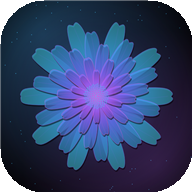
</p>

<h1 align="center">SOUNDFRAME</h1>

<p align="center">
  <b>Every sound has a shape. Discover yours.</b><br>
  Turn your voice, music and the world around you into generative art, entirely on your device.
</p>

<p align="center">
  
  
  
  
  
</p>

<p align="center">
  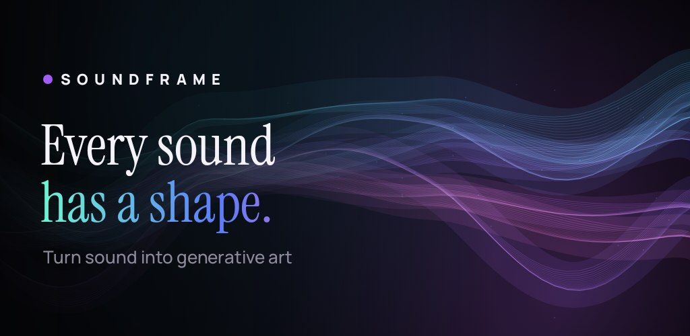
</p>

SOUNDFRAME is a native Android app that records (or imports) up to ten seconds of audio, analyses it on the device, and turns the measurements into a generative artwork you can tune, keep in a gallery, and export as a high-resolution PNG or an MP4 video.

Everything runs offline. No account, no network calls, no cloud processing.

## Screenshots

<p align="center">
  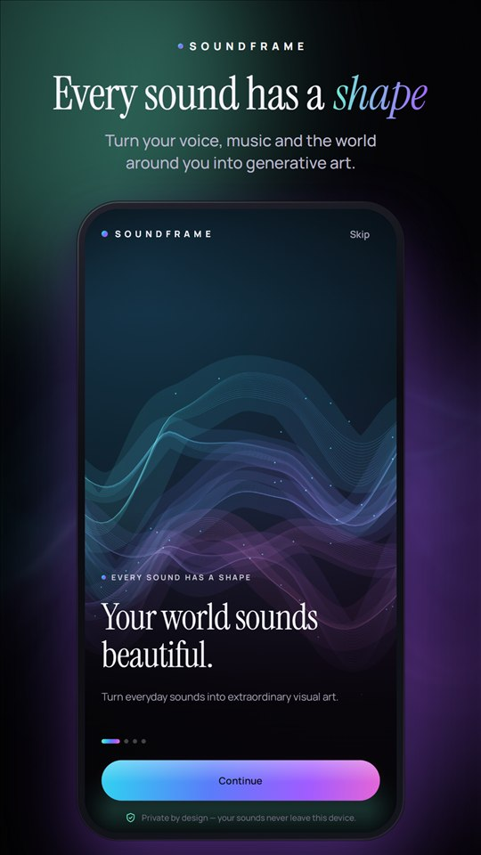
  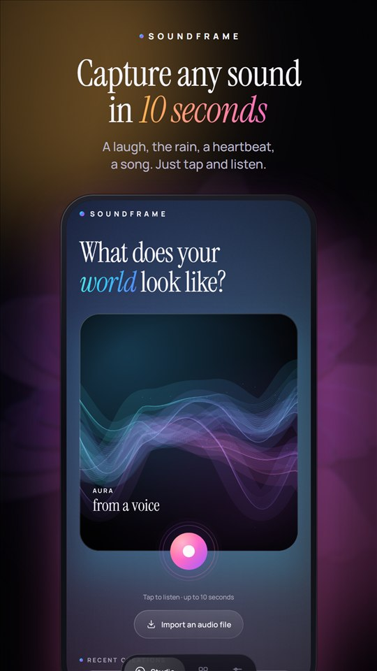
  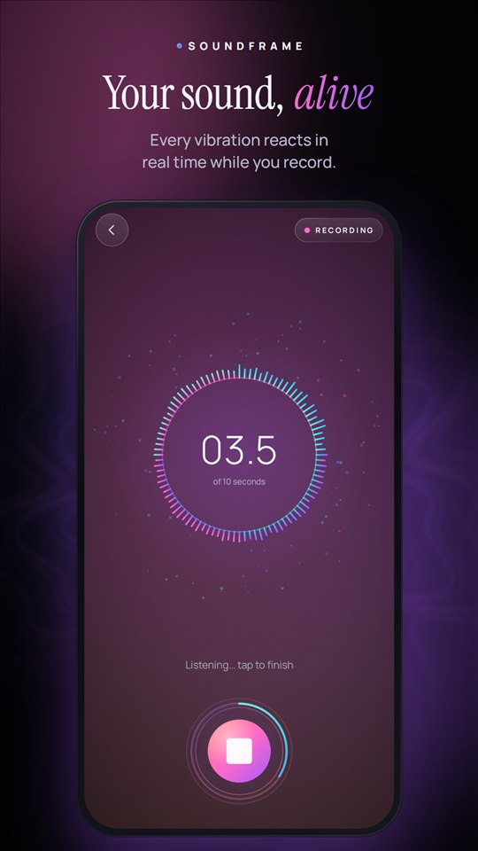
  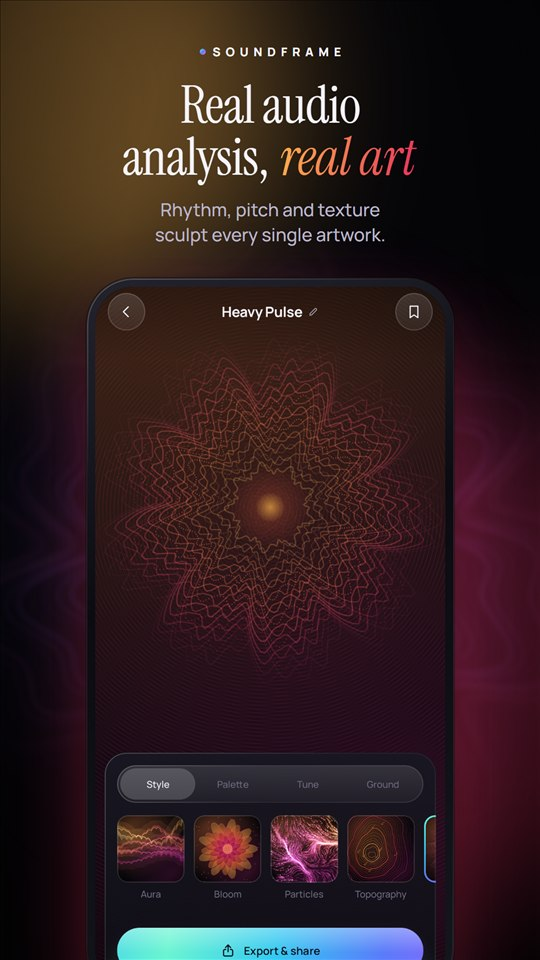
</p>
<p align="center">
  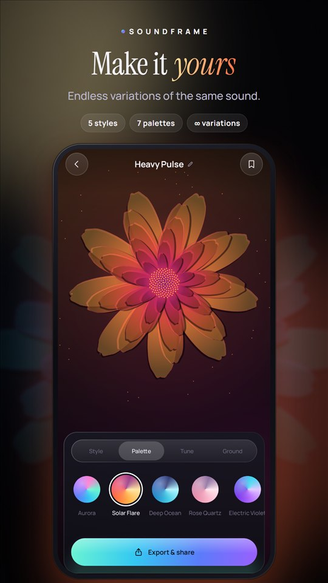
  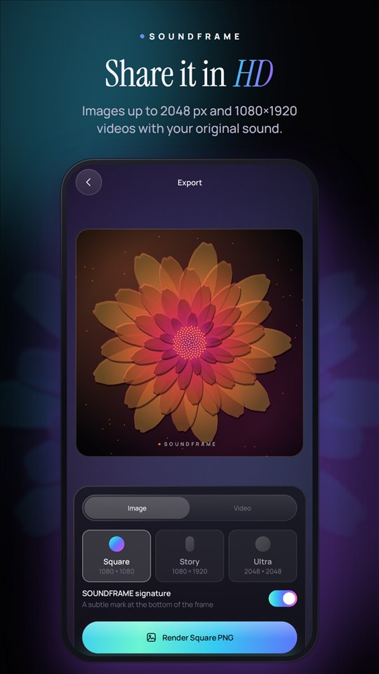
  
</p>

<details>
<summary><b>Versión en español</b></summary>
<br>
<p align="center">
  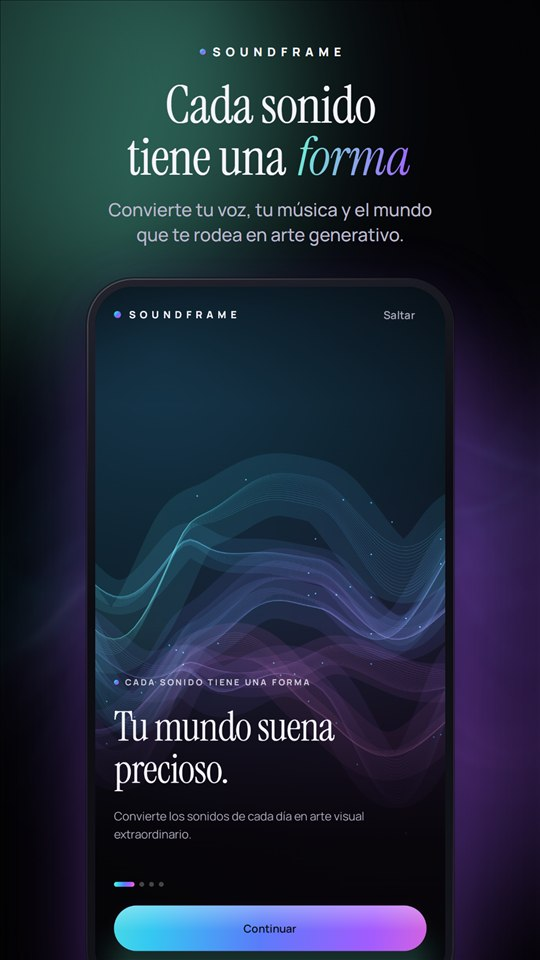
  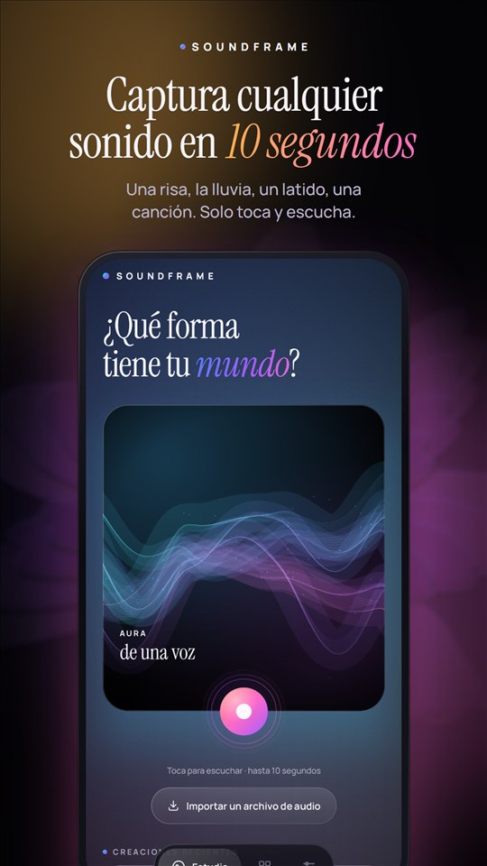
  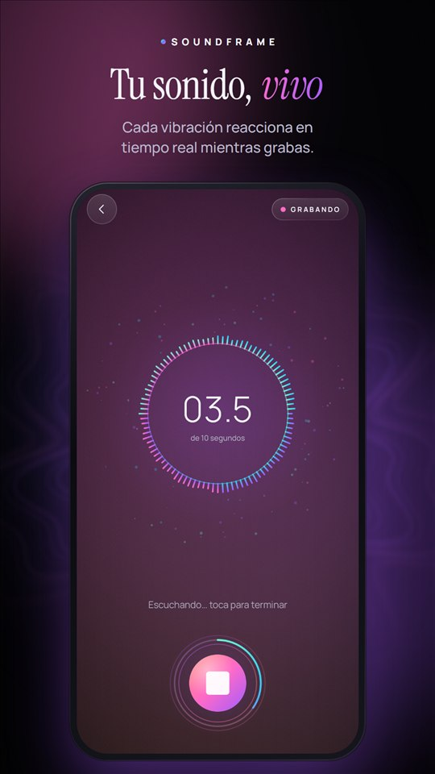
  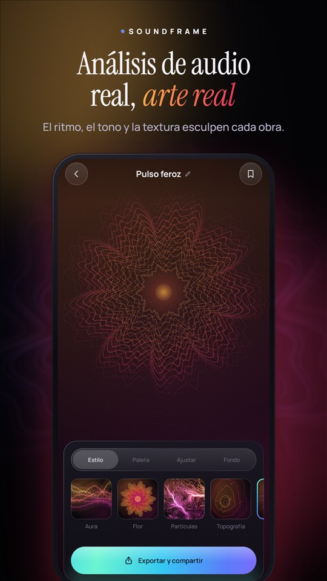
</p>
<p align="center">
  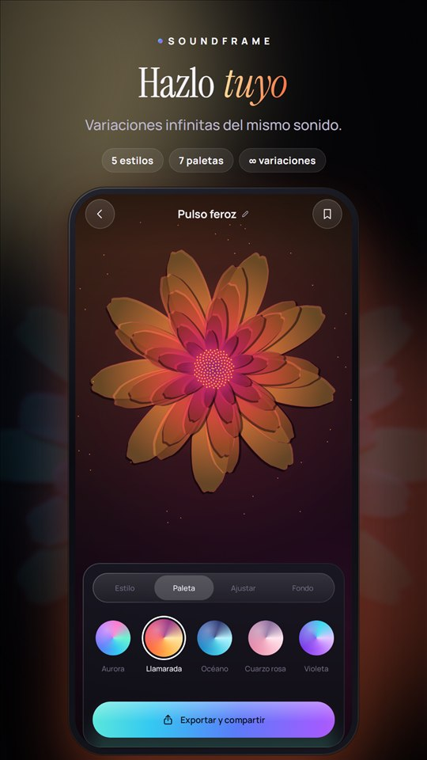
  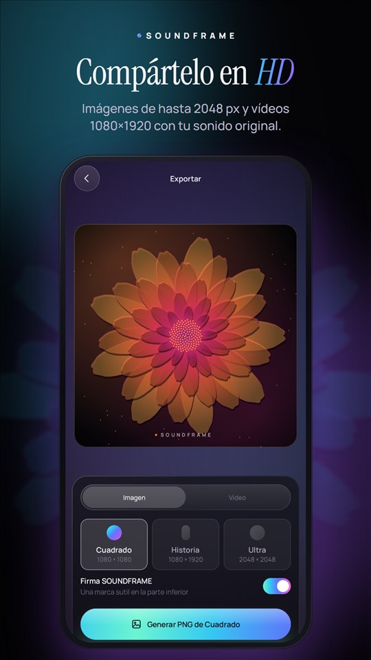
  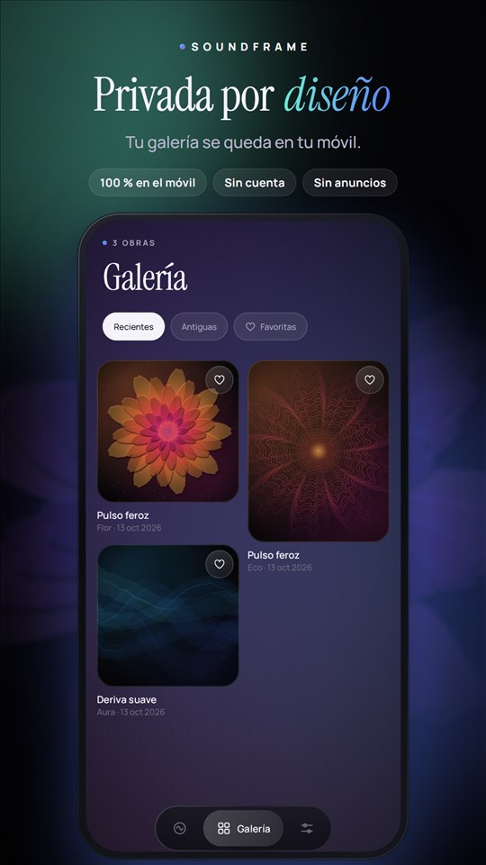
</p>
</details>

### The five styles

| Aura | Bloom | Particles | Topography | Echo |
|:---:|:---:|:---:|:---:|:---:|
| Luminous silk ribbons that follow the energy envelope | Petals sculpted by the spectrum | Thousands of particles in a flow field | The sound as a contoured landscape | Rings that carry each moment outward |

> Screenshots are real captures from a Pixel 9 Pro XL, showing artworks generated from live microphone recordings and imported audio.

---

## Build & run

Requirements: Android Studio with SDK platform **37** installed, and JDK 17+ (Android Studio's bundled JBR works).

```bash
./gradlew assembleDebug              # build the APK
./gradlew testDebugUnitTest          # 54 JVM unit tests
./gradlew connectedDebugAndroidTest  # instrumented tests (needs a device/emulator)
./gradlew lintDebug
```

On Windows without `java` on the PATH:

```powershell
$env:JAVA_HOME = "C:\Program Files\Android\Android Studio\jbr"; .\gradlew.bat assembleDebug
```

| | |
|---|---|
| minSdk / targetSdk / compileSdk | 30 / 36 / 37 |
| Toolchain | AGP 9.3.3 (built-in Kotlin), Kotlin 2.4.21, KSP 2.3.12, Gradle 9.5 |
| Libraries | Compose (BOM 2026.02.01), Navigation Compose 2.10 (type-safe routes), Room 2.8, DataStore 1.2, Koin 4.2, kotlinx-serialization, coroutines |

There are no other runtime dependencies. Image loading, audio decoding, rendering, and video encoding all use platform APIs.

## Permissions

| Permission | Why | When |
|---|---|---|
| `RECORD_AUDIO` | Capturing a sound | Requested only when the user taps record, with a rationale card. A permanent denial sends the user to app settings. |

That's the only permission. Imports go through the system document picker, and "Save to device" uses MediaStore (no storage permission needed on API 29+). Backups and device transfer are disabled (`allowBackup=false` plus exclusion rules), so recordings never leave the device unless the user shares them.

---

## Architecture

There is a single `:app` module, layered by package. Clean Architecture boundaries are enforced by convention and by a unit test that fails if anything under `domain/` imports `android.*` or `androidx.*`.

```
com.mutissx.soundframe
├── app/            Application, MainActivity, typed navigation routes, Koin modules
├── domain/         Pure Kotlin: models, repository interfaces, use cases
│   ├── model/        AudioFeatures, Artwork, ArtworkSettings, VisualParams, typed errors
│   ├── repository/   AudioRecorder, AudioDecoder, ArtworkRepository, ArtworkExporter, FeatureEntitlements…
│   └── usecase/      VisualParamMapper, ArtDirection, Save/Rename/Delete/Export… use cases
├── data/           Implementations: AudioRecord recorder, MediaCodec decoder, Room, DataStore,
│                   thumbnail renderer, PNG/MP4 exporter, in-memory+cache creation sessions
├── core/
│   ├── audio/        FFT, FeatureExtractor, OnsetDetector, WAV codec, PCM utils (pure Kotlin)
│   ├── graphics/     Generative engine: 5 renderers, palettes, seeded RNG/noise, composer
│   ├── designsystem/ Tokens, theme, custom components, icon set, ArtworkCanvas bridge
│   └── common/       Dispatchers, storage paths, share/format helpers
└── feature/        onboarding · home · recording · generation · editor · gallery ·
                    artworkdetail · export · settings  (Screen + ViewModel + immutable UiState)
```

- **MVVM with unidirectional data flow.** Each ViewModel exposes an immutable `StateFlow<UiState>`, accepts a sealed `Action`, and emits one-off `Effect`s through a `Channel`. Composables never touch repositories.
- **Koin.** Modules are `core`, `data`, `domain`, and `feature`. ViewModels that need navigation arguments receive the typed route through `parametersOf(route)`, which keeps them constructible in plain JVM tests.
- **Persistence.** Room stores metadata only, plus the analysed `AudioFeatures` and `ArtworkSettings` as small JSON documents, so any artwork can be re-rendered at any resolution without re-analysis. Audio (`filesDir/audio/*.wav`), thumbnails (`filesDir/thumbnails/*.webp`), and exports (`cacheDir/exports`, shared via `FileProvider`) are files. If a row's JSON is corrupt, that row is skipped rather than breaking the gallery. A missing thumbnail is regenerated from the stored features, and missing audio hides the playback option.
- **Creation sessions.** A new recording lives in memory and is mirrored as a WAV in the cache. If the process dies between recording and saving, the session is reloaded from that file and its features are recomputed.
- **Monetization-ready.** `FeatureEntitlements` gates `ULTRA_RESOLUTION_EXPORT`, `VIDEO_EXPORT`, and `BRANDING_REMOVAL`. The MVP binds `FreeEntitlements`, which unlocks everything. Recording, analysis, all five styles, saving, and PNG export are deliberately not gated at all.

## Audio analysis (`core/audio`)

The analysis uses 2048-sample frames (46 ms at 44.1 kHz) with a periodic Hann window and a 512-sample hop (75% overlap), on an iterative radix-2 FFT with precomputed twiddles. It runs on `Dispatchers.Default` and is cooperatively cancellable.

| Feature | Method |
|---|---|
| RMS, peak, crest factor, clipping ratio, ZCR | Time domain, after DC-offset removal |
| Dynamic range | p95 − p10 of active-frame levels (dB) |
| Spectral centroid, bandwidth, flatness | Per frame, energy-weighted over non-silent frames only |
| Low / mid / high energy | < 250 Hz / 250 Hz–4 kHz / > 4 kHz shares of spectral power |
| Spectral flux & onsets | Log-compressed, half-wave-rectified flux; adaptive median threshold with an absolute floor; 60 ms minimum gap |
| Rhythmic regularity | 1 − CV of inter-onset intervals, reported **only with ≥ 4 onsets**, otherwise `null`. No BPM is ever claimed for arbitrary sounds. |
| Envelope, flux series, spectrum profile | 64 / 64 / 32 points, normalised 0..1 |
| Quality flag | `OK`, `MOSTLY_SILENT`, `CLIPPED`, `TOO_SHORT`. Silence and empty input produce defined zeros, never NaN. |

## Generative engine (`core/graphics`)

`VisualParamMapper` (domain, pure) maps features deterministically to `VisualParams`:

| Audio | Visual |
|---|---|
| RMS energy | intensity, background glow |
| Low-frequency share | weight: thickness, roundness, curvature |
| High-frequency share + ZCR | fine detail, particles, dust |
| Spectral centroid | position within the palette (brightness) |
| Spectral bandwidth | spatial spread / palette range |
| Dynamic range | contrast |
| Spectral flatness | turbulence (noise vs tone) |
| Onset density + regularity | repetition (rings, peaks, attractors) |
| Flux + onsets | motion speed |
| Energy envelope / spectrum | ribbon paths, ring brightness, petal sculpting, terrain summits |

**Reproducibility.** The seed is a FNV-1a hash of the quantised features, mixed with the user's variation index through SplitMix64. The engine uses its own `Rng` (SplitMix64) and Perlin noise rather than `kotlin.random`, so the output can't drift between library versions. `ENGINE_VERSION` is stored with every artwork.

**The five styles** are five separate algorithms:

- **Aura**: bundles of fine strands forming silk ribbons that follow the envelope, with a twisting sheen and screen-blended halos.
- **Bloom**: layered petals with the sound's rotational symmetry, each silhouette sculpted by the mirrored spectrum, plus a phyllotaxis core and orbiting pollen.
- **Particles**: up to 5,000 trajectories integrated once through a seeded flow field with flux-driven vortices. Animation only slides heads along the precomputed paths.
- **Topography**: a domain-warped fBm terrain whose summits come from the envelope, contoured with marching squares, with an animated survey-light sweep.
- **Echo**: harmonically distorted rings that each carry one moment of the envelope and travel outward over a moiré interference field.

**Rendering.** Each style implements `ArtRenderer.prepare(scene, w, h): PreparedArt`. All heavy geometry is built off the main thread, and `PreparedArt` splits drawing into `drawStatic` and `drawDynamic(time)`. In Compose, the static layer is cached in an offscreen GPU layer, and only the dynamic layer redraws, reading time in the draw phase so animation causes no recomposition. Animation pauses when the lifecycle isn't resumed.

**One code path.** The same `ArtworkComposer` draws previews, thumbnails, PNGs, and video frames. Exports are re-rendered at the target resolution, never upscaled from a preview.

**AGSL.** The animated ambient background uses a `RuntimeShader` on Android 13+ and falls back to layered radial gradients on API 30–32. The artworks themselves don't use AGSL, so exports look the same on every device.

## Export & sharing

- **PNG** at 1080×1080, 1080×1920 (the composition is re-laid out for portrait, not stretched), or 2048×2048, with an optional subtle SOUNDFRAME signature. Free space is checked before writing (`StatFs`), and files are written atomically.
- **MP4** at 1080×1920 / 30 fps, H.264, 3–10 s, with an optional AAC track from the original recording. Frames are rendered on a software canvas, converted to YUV 4:2:0, and queued through `MediaCodec.getInputImage` with **explicit presentation timestamps**. Surface input would stamp frames with wall-clock time and distort the playback speed. The muxer is fed through `MediaMuxer`. Progress reported in the UI is real encoder progress. Cancelling the coroutine aborts the encode, releases the codecs, and deletes the partial file. If the device can't encode 1080×1920, the export falls back to 720×1280.
- **Sharing** goes through the Android Sharesheet with a `FileProvider` content URI. Only `cache/exports/` is exposed. **Save to device** writes to `Pictures/Soundframe` or `Movies/Soundframe` via MediaStore.

## Design system

The visual direction is deep charcoal grounds, a five-colour luminous signature gradient, frosted-glass surfaces, an editorial serif (**Instrument Serif**) for emotional moments, and a precise grotesk (**Manrope**, a variable font) for UI. Both fonts are bundled under the SIL OFL; see `licenses/`.

All components are custom:
- `LuminousButton` (a drifting gradient with a coloured glow), `GhostButton`, and `GlassIconButton`
- `RecordOrb`: a breathing orb that morphs into a stop square, with level ripples and a 10-second budget arc
- `SfSlider`, `SfSwitch`, `SegmentedTabs`, `PaletteSwatch`, and `SfDialog`
- `ArtLoader`: Lissajous particles instead of a spinner
- `SfBottomBar`: a floating pill
- A hand-drawn 24-unit icon set

Motion and spacing tokens are shared across screens. Reduce-motion comes from the in-app setting or from the system animator scale being set to 0. The UI uses ≥ 48 dp touch targets, content descriptions and roles on custom controls, and live regions for status text.

## Tests

- **Unit tests (54, JVM):**
  - FFT against a naive DFT, tone peak bin, Parseval, Hann window
  - Feature extraction: RMS and peak of a sine, centroid tracking, band separation, ZCR, noise vs tone flatness, silence, empty and very short input, clipping, onsets and regularity on clicks, no rhythm claimed for a steady tone, dynamic range, envelope, DC offset, cancellation
  - WAV round-trip and corrupt WAV; resampling and downmixing
  - Visual mapping: determinism, bounds, distinguishability, variations, monotonic controls
  - Domain purity check
  - Use cases with fakes: caching, expired session, too-short recording, save with and without keeping audio, update preserves features, insufficient storage, rename validation, favourites, delete cleanup, thumbnail regeneration, entitlement gating, video clamping
  - Corrupt-row mapping
  - ViewModels (coroutines-test + Turbine): permission request and permanent denial, successful recording, microphone failure, background interruption, editor edits and save, save-then-export, variations, image export success and storage failure, video export cancellation and cleanup
- **Instrumented tests (2):** a Room DAO test (sorting, favourites, rename, delete) and a Compose navigation flow (onboarding → Studio → Gallery → Settings).

## Localisation

All UI text lives in string resources, with English as the default (`values/`) and Spanish in `values-es/`. Lint's missing-translation check passes.
- **Per-app language:** Android 13+ gets it via a generated locale config.
- **Generated titles:** these localise too. Spanish uses noun + gender-invariant adjective ("Pulso feroz", "Deriva suave") so the grammar always agrees.
- **Errors:** ViewModels expose `@StringRes` IDs, never raw text.

## Store kit

`store/` contains the Play Store submission kit:
- localised listings in fastlane `supply` layout
- the 512 px icon and 1024×500 feature graphics, rendered by the app's own engine
- 7 phone screenshots per language, captured on a Pixel 9 Pro XL
- the privacy-policy site, deployed at https://soundframe-privacy.vercel.app/ (Spanish at `/es/`)

See `store/PLAY_CONSOLE.md` for every console field, the Data safety answers, and the remaining steps (signing and testing track).

## Verification status

Verified on a **Pixel 9 Pro XL (Android 17)**:
- a real microphone recording, with contextual permission
- a WAV import through the document picker
- the editor, saving, the gallery, and export
- Spanish and English UI, switched via per-app locale
- the Settings privacy-policy link

Real-device testing led to three fixes:
- **Aura frame rate.** Home ran at about 27 fps with 40% jank. Aura's strands were moved from per-frame `Path`s to batched `drawLines`, bringing it to about 59 fps with 5.8% jank.
- **Quiet sounds.** A real quiet room (around −55 dBFS) was being classified as silence and given the grey palette. The silence threshold and the energy curve are now calibrated against that recording, with a regression test.
- **Quiet artworks.** A higher intensity floor keeps soft sounds luminous.

Also verified on an **Android 16 emulator**:
- PNG export, with the pulled file checked: 1080×1080
- the Sharesheet
- a 10-second MP4 export, with the pulled file checked: one H.264 and one AAC track, duration 10.05 s
- the Room DAO test and the Compose navigation test

Not yet verified, or with known limitations:
- **API 30–32.** The non-AGSL background fallback compiles but hasn't been run on those API levels.
- **MP4 playback.** The file's container and tracks were validated, but the video wasn't watched frame by frame in a player.
- **Other styles' frame rates.** Bloom, Echo, Particles and Topography haven't been individually profiled on a mid-range device.
- **Rendering speed.** Video export renders on the CPU: about 14 s for a 10 s clip on the emulator. It is cancellable and shows real progress.
- **Long imports.** Only the first 10 seconds of an imported file are analysed.
- **Stills.** PNGs and thumbnails use the canonical still frame (`t = 0`). An animated preview shows the same composition in motion, and turning animation off in the editor shows exactly the exported frame.
- **Billing.** Not integrated (by design for the MVP); the entitlement abstraction is in place.

## Signing

The release build is signed with an **upload key** that is stored outside the repository, in `../Soundframe-keys/`:
- `soundframe-upload.jks`: PKCS12, RSA 4096, alias `soundframe-upload`, valid until 2054
- `keystore.properties`: the keystore path and passwords, read by `app/build.gradle.kts`

If that folder is missing, release builds are produced unsigned rather than failing. Back up both files somewhere safe. With Play App Signing, a lost upload key can be reset through Play support, but the reset is slow.

```bash
./gradlew bundleRelease   # → app/build/outputs/bundle/release/app-release.aab
```

Increase `versionCode` in `app/build.gradle.kts` before every new upload.

## Release builds and R8

Since 1.0.1 (versionCode 2), release builds run **R8** (`optimization { enable = true }`), which shrinks, optimises and obfuscates the code. The APK went from 29.6 MB to 3.6 MB, and the AAB from 10.6 MB to 4.8 MB.
- **Deobfuscation file.** It's embedded in the AAB automatically (`BUNDLE-METADATA/com.android.tools.build.obfuscation/proguard.map`), so Play Console deobfuscates crash and ANR reports. Every release's `mapping.txt` is also archived in `release/`.
- **Keep rules.** These are in `app/src/main/keepRules/rules.keep`. The persisted models (`domain.model`) and the navigation routes keep their names, so artworks saved by older versions always decode.
- **Upgrade verified on the Pixel 9 Pro XL.** An artwork saved with 1.0 (no R8) opened, played and exported (PNG and MP4) after upgrading in place to 1.0.1 (R8).
